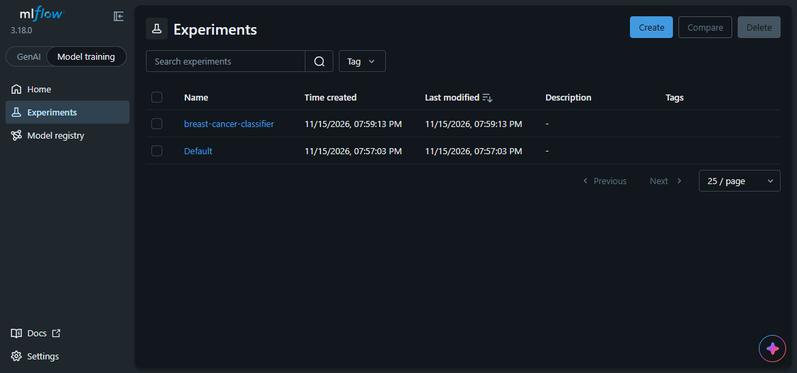
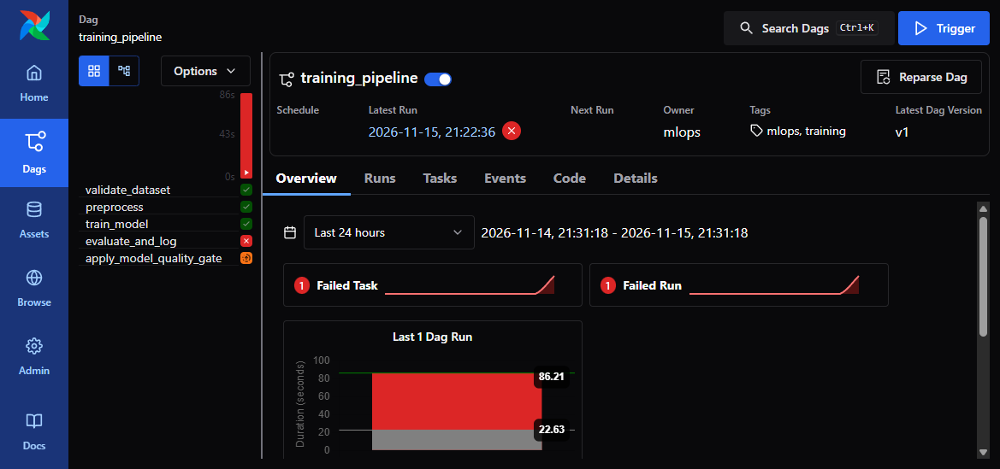
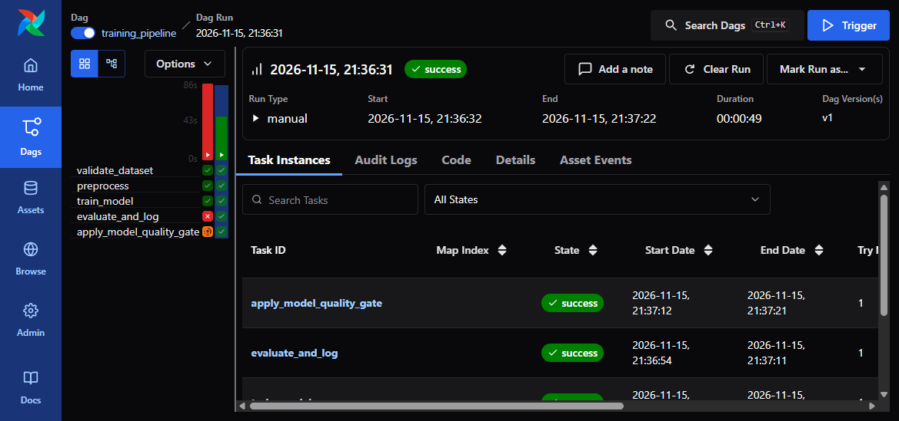
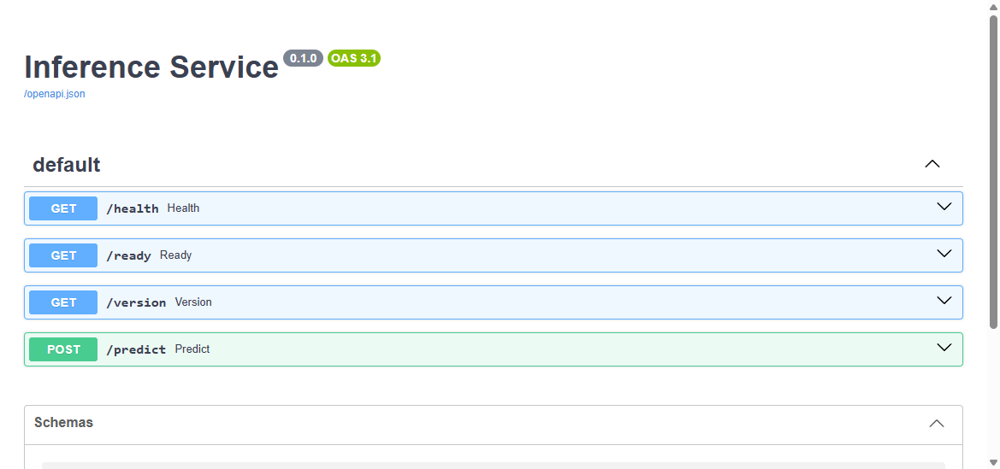
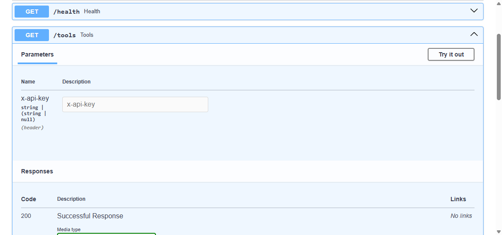

# Technical Report - MLOps AI Agent (Assignment 03)

## 1. System architecture

The system is a FastAPI agent (`agent/main.py`) backed by an orchestrator, a
tool registry, permission checks, structured evidence, and an optional
OpenAI-compatible LLM adapter. The registered tools cover:

- DVC data provenance and safe checkout;
- MLflow experiments, runs, comparison, and registry;
- Airflow 3 DAG inspection, triggering, and diagnostics;
- Kubernetes workload inspection, diagnosis, version checks, and controlled
  restart.

The agent operates an inference API in `api/main.py`. The API is packaged by
`Dockerfile` and deployed by the Kubernetes manifests in `kubernetes/`.
GitHub Actions runs Ruff and pytest for pull requests.

## 2. Tools, permissions, and safety

There are 26 tools: 7 DVC, 7 MLflow, 5 Airflow, and 7 Kubernetes tools. Each
tool has a Pydantic input schema, a JSON-schema description, structured
results, and a permission class.

State-changing operations require API-level confirmation:
`checkout_dataset_version`, `trigger_training_dag`, and
`restart_deployment`. The LLM cannot set confirmation itself. Kubernetes
operations are restricted to namespace `mlops-agent`; Airflow triggers are
restricted to `training_pipeline`; DVC operations use an allow-list. Tool
timeouts and structured logs expose failures instead of returning
success-shaped fallbacks.

## 3. Live evidence

All evidence below was captured from the running local stack on 2026-11-15.

| System | Verified result | Evidence |
|---|---|---|
| DVC | Current workspace matches `data-v2`; md5 `761733f980870acabad9ead42a09fe8a`; commit `6af2456` | `evidence/dvc.txt`, live agent JSON |
| MLflow | Experiment `breast-cancer-classifier`; successful run `61fc62922cd64d7eb8862e1e39377030`; F1 `0.97561`; gate passed | `evidence/live-agent-mlflow.json`, `screenshots/mlflow_runs.png` |
| Airflow | `training_pipeline` latest run succeeded; all five tasks succeeded | `evidence/airflow-live.txt`, `screenshots/airflow_run_success.png` |
| Kubernetes | `iris-inference` is healthy with 2/2 replicas, image `mlops-inference:1.0.0`, dataset `data-v2`, model run `82ac68fa015345afa553f1c4898660b8` | `evidence/kubernetes.txt`, `evidence/live-agent-kubernetes.json` |
| Agent | Live DVC, MLflow, Airflow, Kubernetes, and multi-tool requests completed with evidence and uncertainty reporting | `evidence/live-agent-*.json`, `screenshots/agent_chat.png` |

### Screenshot evidence

The screenshots are ordered from experiment tracking, through orchestration,
to serving and agent interaction:

1. 
2. 
3. 
4. 
5. 

The Airflow container originally lacked MLflow. This was fixed in the running
container and made reproducible with `Dockerfile.airflow`, which builds
`mlops-airflow:3.0.6-mlflow`.

The successful Airflow run was:

```text
manual__2026-11-15T16:36:31.372846+00:00_lqRXpJF7
validate_dataset          success
preprocess                success
train_model               success
evaluate_and_log          success
apply_model_quality_gate  success
```

The run logged MLflow metrics: F1 `0.97561`, accuracy `0.96951`, precision
`0.97087`, and recall `0.98039`.

## 4. Agent conversation evidence

Five live conversations were captured as JSON so the exact tool calls and
structured evidence are auditable:

1. Dataset provenance: `evidence/live-agent-dataset.json`
2. MLflow model selection: `evidence/live-agent-mlflow.json`
3. Airflow run and task status: `evidence/live-agent-airflow.json`
4. Kubernetes deployment diagnosis: `evidence/live-agent-kubernetes.json`
5. Multi-tool reasoning across MLflow, DVC, Kubernetes, and Airflow:
   `evidence/live-agent-multitool.json`

The current MLflow runs tie at F1 `0.97561`; the newest successful run is
selected by recency, not by a false claim of metric superiority. The agent
also reports that offline F1 does not establish production readiness without
latency, error-rate, or drift evidence.

## 5. Failure investigations

### 5.1 Data layer: DVC detects an untracked modification

Appending an invalid row to `data/dataset.csv` without `dvc add` caused
`detect_data_changes` to report that the workspace differed from the DVC
pointer. The safe resolution was to restore the tracked version with DVC;
the pipeline validation stage then passed again. Detailed evidence is in
`evidence/failure_investigations.md`.

### 5.2 Model layer: quality gate blocks promotion

A weak model configuration was evaluated against a strict F1 threshold. The
quality gate raised an error because the measured F1 was below the threshold,
tagged the run as failed, and did not promote or register it. The failure is
documented in `evidence/failure_investigations.md`.

### 5.3 Infrastructure layer: live Kubernetes failures

Two failures were injected against the real Docker Desktop Kubernetes
cluster:

1. A nonexistent image tag produced `ErrImagePull`/`ImagePullBackOff` and no
   ready service endpoints.
2. An invalid `MODEL_PATH` left pods running but failing readiness with HTTP
   503; rollout readiness correctly timed out.

Both mutations were reverted. The final deployment is healthy at 2/2 ready
replicas. Raw resource and rollout evidence is in `evidence/kubernetes.txt`;
the investigation narrative is in `evidence/failure_investigations.md`.

## 6. Validation

The repository validation completed successfully:

- pytest: 87 passed, 2 skipped (integration skips when the optional external
  runtime is unavailable);
- Ruff lint: passed;
- Ruff format check: passed;
- Python compilation: passed;
- Kubernetes manifest parsing: passed;
- CI YAML parsing: passed;
- live inference `/health` and `/ready`: passed;
- live Airflow health endpoint: passed;
- live Airflow DAG run: 5/5 tasks passed;
- live Kubernetes deployment: 2/2 replicas ready.

## 7. Limitations

- The MLflow runs use offline evaluation; production promotion should also
  use serving latency, error-rate, and drift monitoring.
- The Airflow demo uses a local work directory. A distributed executor would
  require shared storage or artifact passing.
- The DVC remote is local for this assignment; production use should use a
  restricted remote object store.
- The LLM planner is optional. The rule planner remains available for
  deterministic offline operation and tests.

## 8. Submission artifacts

- Report: `technical_report.md`
- Architecture and tool permissions: `architecture.md`
- Live evidence: `evidence/`
- Screenshots: `screenshots/`
- Kubernetes manifests and failure recipes: `kubernetes/`
- Airflow image fix: `Dockerfile.airflow`
- Tests and CI: `tests/`, `.github/workflows/ci.yml`

No `.env`, API key, Airflow password, kubeconfig, or other secret is included
in the submission files.
